<!-- ✦ Handmade animated SVGs live in /assets — generated, not templated. ✦ -->

<a href="https://thirthpatel2-web.github.io"></a>

<p align="center">
  <a href="https://thirthpatel2-web.github.io"></a>
  <a href="https://thirthpatel2-web.github.io/Thirth_Patel_Resume.pdf"></a>
  <a href="https://www.linkedin.com/in/thirth-p-a23aa0339"></a>
  <a href="mailto:thirthpatel2@gmail.com"></a>
  
</p>

<p align="center">
  <a href="https://thirthpatel2-web.github.io"></a>
  <br/>
  <sub>3D portfolio · career timeline · a terminal you can type into (press <kbd>/</kbd>) — <a href="https://thirthpatel2-web.github.io">thirthpatel2-web.github.io</a></sub>
</p>

&nbsp;

> [!NOTE]
> **TL;DR for recruiters** · 3rd-year **B.Tech ISE (AI & Robotics)**, Presidency University · **CGPA 8.82** · **Smart India Hackathon 2026, Top 142** · **2 industry internships**.<br/>
> I ship **tested, documented, deployed** software: a consent-gated government data gateway with **768 automated tests + CI** and **187 REST APIs**, an **AI-agent benchmark live on Hugging Face**, and computer-vision & NLP apps.<br/>
> **Open to** SDE · AI/ML · backend · full-stack **internships** · 📍 Bengaluru · ✉️ [thirthpatel2@gmail.com](mailto:thirthpatel2@gmail.com)

<p align="center">
  <a href="https://youtu.be/tzFOb6MYcbs"></a>
  <a href="https://huggingface.co/spaces/ThirthPatel/cascade-failure-env"></a>
  <a href="https://thirthpatel2-web.github.io/disastershield-ai/"></a>
  <a href="https://github.com/thirthpatel2-web/Civiclens/actions/workflows/ci.yml"></a>
</p>

&nbsp;

## `> ./impact --numbers`



&nbsp;

## `> git log --graph ~/career`



<details>
<summary><code>> git show --stat</code> &nbsp;·&nbsp; what I actually did at each stop</summary>
<br/>

| When | Role | What shipped |
|---|---|---|
| **Sep 2026** | 🏆 Smart India Hackathon 2026 · **Top 142** (Presidency University internal round) | [CivicLens](https://github.com/thirthpatel2-web/Civiclens) for SIH26129: consent-first data exchange between departments · 187 REST operations · 50 screens · 10 languages · RAG over 38,238 judgments · 768 tests in CI |
| **Jul – Sep 2026** | 💼 **Full-Stack Web Development Intern**, Technofenatics Solutions LLP (Sattix) | Features on a live PHP + SQLite platform in a ticket-based workflow: admin-configurable settings with no code deploy or DB migration; caching-related UI bugs root-caused in DevTools and fixed with cache busting |
| **2026** | ⚡ Hackathons: Meta × Hugging Face OpenEnv · FusionX 2026 · Hack Devengers 2.0 | [Cascade Failure Env](https://huggingface.co/spaces/ThirthPatel/cascade-failure-env) (AI-agent SRE benchmark) · [IRIS](https://github.com/thirthpatel2-web/disaster-intel) (disaster intelligence) |
| **Jan – Feb 2026** | 💼 **Web Development Intern**, Amdox Technologies | [JobConnect](https://github.com/thirthpatel2-web/job-listing-portal): Node.js + Express portal, JWT auth, role-based access, 5-stage hiring pipeline |
| **2024 – 2028** | 🎓 **B.Tech, Information Science & Engineering (AI & Robotics)**, Presidency University | CGPA 8.82 · certifications: Infosys Springboard (SQL, MySQL), Corizo (web development) |

</details>

&nbsp;

## `> ./play civiclens.mp4`

<p align="center">
  <a href="https://youtu.be/tzFOb6MYcbs"></a>
  <br/>
  <sub><b>One citizen. One consent click. Every department already knows.</b> · 6:46 demo of the SIH 2026 build</sub>
</p>

&nbsp;

## `> ls ~/projects --best`

<p align="center">
  <a href="https://github.com/thirthpatel2-web/Civiclens"></a>
  <a href="https://github.com/thirthpatel2-web/cascade-failure-env"></a>
  <a href="https://github.com/thirthpatel2-web/disaster-intel"></a>
  <a href="https://github.com/thirthpatel2-web/Road_scan_AI-"></a>
  <a href="https://github.com/thirthpatel2-web/AI-Resume_Analyser"></a>
  <a href="https://github.com/thirthpatel2-web/EthicaMind"></a>
</p>

<details>
<summary><code>> ls ~/projects --all</code></summary>
<br/>

| | Project | What it is |
|:-:|---|---|
| 🎯 | [SkillSense](https://github.com/thirthpatel2-web/Skillsense) | Résumé → predicted career track (TF-IDF + logistic regression) + skills to learn next |
| 🛡️ | [DisasterShield AI](https://github.com/thirthpatel2-web/disastershield-ai) | React disaster-response console: simulation, SOS alerts and a Groq analyst |
| 💼 | [JobConnect](https://github.com/thirthpatel2-web/job-listing-portal) | Job portal with seeker/employer roles, JWT auth and application tracking (built at Amdox) |
| 🎓 | [Student CRUD Dashboard](https://github.com/thirthpatel2-web/student-crud-dashboard) | Express + MongoDB REST API with a lightweight dashboard |

</details>

&nbsp;

## `> ./recruiter --role <yours>`

> Hiring for something specific? Open your role. Every line points at code you can read.

<details>
<summary>🤖 <b>AI / ML engineer intern</b></summary>
<br/>

- **LLM + RAG with guardrails:** CivicLens's legal analyzer runs pgvector semantic search over 38,238 Supreme Court records and **refuses to answer what it can't cite** → [Civiclens](https://github.com/thirthpatel2-web/Civiclens)
- **AI agents & evaluation:** an OpenEnv reinforcement-learning environment where LLM agents act as on-call engineers; deterministic graders, shaped rewards, 3 difficulty tiers → [graders.py](https://github.com/thirthpatel2-web/cascade-failure-env/blob/main/graders.py)
- **Speech:** Whisper speech-to-text for complaints in 10 Indian languages → CivicLens
- **Computer vision:** OpenCV pothole detection with a Keras CNN path → [RoadScan AI](https://github.com/thirthpatel2-web/Road_scan_AI-)
- **Classical ML / NLP, explainable:** TF-IDF + cosine similarity and logistic regression with scores you can trace → [Signal](https://github.com/thirthpatel2-web/AI-Resume_Analyser) · [SkillSense](https://github.com/thirthpatel2-web/Skillsense)
- **Responsible AI:** crisis screening runs *before* any LLM call → [EthicaMind](https://github.com/thirthpatel2-web/EthicaMind/blob/main/backend/app.py)

</details>

<details>
<summary>⚙️ <b>Backend / SDE intern</b></summary>
<br/>

- **APIs for a real product:** 187 REST operations + WebSockets on FastAPI → [API contract](https://github.com/thirthpatel2-web/Civiclens/blob/main/docs/API_CONTRACT.md)
- **Data & systems:** PostgreSQL + Alembic migrations, Redis streams, consent ledger, per-hop tracing → [architecture diagrams](https://github.com/thirthpatel2-web/Civiclens/blob/main/docs/ARCHITECTURE_DIAGRAMS.md)
- **Performance:** load-tested; made the API ~10× faster under load by removing a per-request Argon2 hash
- **Testing & CI:** 768 tests (unit · integration · end-to-end), ruff, mypy, GitHub Actions → [tests](https://github.com/thirthpatel2-web/Civiclens/tree/main/tests)
- **Production code in industry:** shipped changes to a live PHP + SQLite app at Technofenatics (Sattix) without migrations
- **Distributed systems thinking:** cascade failures across a 12-service graph → [Cascade Failure Env](https://github.com/thirthpatel2-web/cascade-failure-env)

</details>

<details>
<summary>🌐 <b>Full-stack intern</b></summary>
<br/>

- **End-to-end product:** 50-screen web app with roles for citizens, officers and admins → [CivicLens](https://github.com/thirthpatel2-web/Civiclens)
- **Node.js stack:** Express + JWT + role-based access + hiring pipeline → [JobConnect](https://github.com/thirthpatel2-web/job-listing-portal)
- **React:** 9-tab disaster console, auto-deployed to GitHub Pages → [DisasterShield AI](https://thirthpatel2-web.github.io/disastershield-ai/)
- **Real-time UI:** WebSocket alert feed on a Leaflet map → [IRIS](https://github.com/thirthpatel2-web/disaster-intel)
- **Craft:** a three.js portfolio with a working in-page terminal → [thirthpatel2-web.github.io](https://thirthpatel2-web.github.io)

</details>

&nbsp;

## `> cat ~/.toolbox`

<p align="center">
  
  <br/>
  
  <br/>
  
  <br/>
  
</p>

<p align="center">
  
  
  
  
  
  
</p>

&nbsp;

## `> grep -r "proof" ~/work`

> Skills are easy to list. Here's where each one is **actually used**, one click from the code.

| What recruiters check | Where you can see it |
|---|---|
| 🏢 **Industry experience** | Full-stack intern at **Technofenatics (Sattix)**: live PHP + SQLite product, ticket-based workflow · Web dev intern at **Amdox**: built [JobConnect](https://github.com/thirthpatel2-web/job-listing-portal) |
| 🧪 **Testing** | [768 automated tests](https://github.com/thirthpatel2-web/Civiclens/tree/main/tests) across unit, API, live-database and end-to-end suites |
| 🔁 **CI / CD** | [CI on every push](https://github.com/thirthpatel2-web/Civiclens/actions/workflows/ci.yml) (lint, types, tests) · [auto-deploy to GitHub Pages](https://github.com/thirthpatel2-web/disastershield-ai/blob/main/.github/workflows/deploy.yml) |
| 🏗️ **System design** | [10 architecture diagrams](https://github.com/thirthpatel2-web/Civiclens/blob/main/docs/ARCHITECTURE_DIAGRAMS.md) · [API contract](https://github.com/thirthpatel2-web/Civiclens/blob/main/docs/API_CONTRACT.md) · [spec-to-code traceability](https://github.com/thirthpatel2-web/Civiclens/blob/main/docs/REQUIREMENT_TRACEABILITY.md) |
| 🔐 **Security & privacy** | [Security policy](https://github.com/thirthpatel2-web/Civiclens/blob/main/SECURITY.md) · [DPDP Act compliance checklist](https://github.com/thirthpatel2-web/Civiclens/blob/main/docs/DPDP_COMPLIANCE_CHECKLIST.md) · consent-first data exchange |
| 🛡️ **Responsible AI** | [Crisis screening before any AI reply](https://github.com/thirthpatel2-web/EthicaMind/blob/main/backend/app.py) · legal AI that withholds answers it can't cite |
| 🤖 **AI agents & evaluation** | [LLM-graded agent benchmark](https://github.com/thirthpatel2-web/cascade-failure-env/blob/main/graders.py) with easy / medium / hard tasks |
| 🚀 **Shipping** | [Dockerised Hugging Face Space](https://huggingface.co/spaces/ThirthPatel/cascade-failure-env) · [live React demo](https://thirthpatel2-web.github.io/disastershield-ai/) · [this 3D portfolio](https://thirthpatel2-web.github.io) |
| 👥 **Teamwork** | Built CivicLens with my team for Smart India Hackathon 2026 (Top 142, internal round) · [6:46 demo video](https://youtu.be/tzFOb6MYcbs) |

&nbsp;

## `> ./stats --live`



<p align="center">
<picture>
  <source media="(prefers-color-scheme: dark)" srcset="https://raw.githubusercontent.com/thirthpatel2-web/thirthpatel2-web/output/snake-dark.svg"/>
  <source media="(prefers-color-scheme: light)" srcset="https://raw.githubusercontent.com/thirthpatel2-web/thirthpatel2-web/output/snake.svg"/>
  
</picture>
</p>

&nbsp;

## `> echo $NOW`

```diff
+ going deeper into AI & Robotics — agents, computer vision, LLM systems
+ turning messy real-world problems into software that actually ships
+ looking for: SDE · AI/ML · backend internships — let's talk
```

<a href="https://thirthpatel2-web.github.io"></a>
